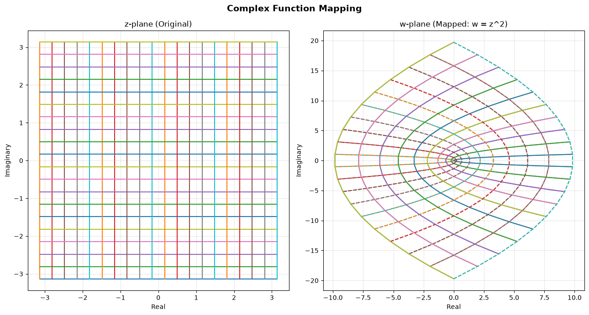

# Complex Analysis, visualized and implemented in code

This is a collection of notes on complex analysis, with the goal of making the subject interactive and visual. A secondary goal is to also provide implementations of the concepts in Python, so that students can explore the subject with code. To support this, the notes are accompanied by a Python package that implements the concepts and provides visualizations.

### What this is

The notes are intended for students who are meeting complex analysis for the first time. They have been designed to be short accompanied by pictures of some concepts and code snippets that create visualizations of the concepts. The notes, however, are not a replacement for a textbook, and I would advise that students read a textbook alongside these notes.



## Start here

Want to get started? Click the button below to go the first note.


## Try it yourself

**Note**: The package is still in development.

The Python package that accompanies the notes can be installed with pip. It's role is to provide a set of tools for visualizing the transformations of supported complex functions. The current version supports the following functions:
- Polynomial functions
- Rational functions
- Trigonometric functions
- Exponential functions

To install the package, run the following command:

```bash
pip install cpxmath
```
Example usage:

```python
from cpxmath import parse_function, analyze

# Define a function of z
function = parse_function("z**2 + 1")

# Check the Cauchy-Riemann equations
result = analyze(function.eval_expr)

print(result)
```

## License

This project is licensed under the MIT License.